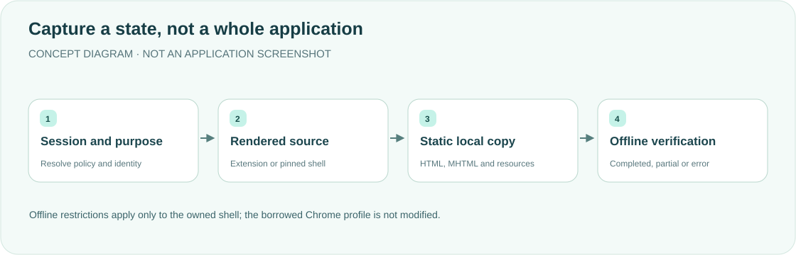

<div align="center">

<h1>huoqu · Keep a page locally</h1>
<p><strong>Save the rendered state—not a fictional copy of an entire website.</strong></p>
<p>Static HTML/MHTML capture and offline verification for DeepSeek Harness.</p>
<p><a href="README.md">简体中文</a> · <strong>English</strong></p>
<p><a href="package.json">v0.2.3</a> · <a href="LICENSE">MIT</a> · DSH desktop plugin</p>
<p><a href="#features">Features</a> · <a href="#how-it-works">How it works</a> · <a href="#quick-start">Quick start</a> · <a href="#purpose-and-identity">Purpose and identity</a> · <a href="#outputs-and-boundaries">Outputs and boundaries</a> · <a href="#validation">Validation</a></p>
</div>

---

A reference for a personal desktop workflow. Normal capture preserves the current Chrome identity; automation and web regression use an owned, anonymous, truly headless backend. An unavailable identity fails explicitly rather than silently becoming anonymous.

## Features

<table><tr>
<td width="33%"><strong>🗃 Static offline copies</strong><br/><br/>Save HTML, resources and MHTML, not the site's APIs, login state or interactive application.</td>
<td width="33%"><strong>🌐 Traceable identity</strong><br/><br/>Reports record purpose, backend, real engine, requested/actual identity, ownership and fallback reasons.</td>
<td width="33%"><strong>🧪 Offline verification</strong><br/><br/>An owned pinned shell checks HTML/MHTML offline with JavaScript disabled, plus source/local screenshots.</td>
</tr><tr>
<td><strong>🖼 Localized resources</strong><br/><br/>Images, CSS and safely inlined SVG paint; incomplete preservation returns partial.</td>
<td><strong>🛡 Session file policy</strong><br/><br/>Official sandboxPolicy/fs and the real loaded Session govern writes, replacement and cleanup.</td>
<td><strong>🧾 Honest outcomes</strong><br/><br/>A saved file is not a pass. Cleanup failure blocks publication; unknown directories are not overwritten.</td>
</tr></table>

## How it works



Default capture uses the [Chrome plugin](https://github.com/yueyexiayu/dsh-chrome) to create a task-owned background target, without a debug port or takeover of existing tabs. Offline restrictions apply only to the owned shell. The source page's own scripts still run during online loading.

## Quick start

The pinned browser is verified only on macOS arm64, actually tested on macOS 27.0.1. Darwin major below 22 is rejected. Other architectures, Linux/Windows and other macOS versions are not claimed verified.

```sh
export DSH_HOME="${DSH_HOME:-$HOME/.dsh}"
git clone https://github.com/yueyexiayu/dsh-huoqu.git "$DSH_HOME/plugins/huoqu"
cd "$DSH_HOME/plugins/huoqu"
npm ci --ignore-scripts
npm run install:headless
```

Load it as a **desktop profile bundle**. Add `huoqu` in both places in `$DSH_HOME/profiles/desktop/package.json`:

- `dependencies`: `link:$DSH_HOME/plugins/huoqu`
- `dsh.profile.bundles`: the string id `huoqu`

Install the profile so `node_modules/huoqu` resolves to this plugin. **Do not** also `- insert:` the same id in desktop `cordis.patch.yml`; bundling and inserting the same id creates two instances.

**Quit DSH fully with ⌘Q, reopen it and start a new session.** The sidebar shows webpage capture. Signed-in capture also needs the paired Chrome plugin/extension. Verify actual sidebar GET `version`, new tool schema and result `pluginVersion` as 0.2.3; disk declarations are not loaded-runtime proof.

Example anonymous web-regression parameters; the output must be new or a verifiably owned previous capture:

```json
{"url":"https://example.com/","purpose":"web-regression","browser_identity":"anonymous","backend":"headless","output_dir":"/tmp/new-capture"}
```

## Purpose and identity

| Item | Default and requirements |
| --- | --- |
| `purpose=capture` | `current` identity using the real Chrome profile; unavailable extension fails |
| `purpose=automation/web-regression` | `anonymous` + owned true headless, never borrowed Chrome |
| `backend` | `auto`, `current-chrome`, `headless`; auto follows purpose/identity, not arbitrary error guessing |
| `browser_identity=prefer-current` | Explicitly permits anonymous fallback only for genuine extension unavailability/absent optional module, with a reason |
| Invalid combinations | headless+current, current-chrome+anonymous and automation+current are rejected |
| Output | Default `~/Downloads/huoqu/`; workspace-write should use the workspace or platform temporary directory |

Protocol, old-extension, permission, engine-version and identity errors never permit fallback. Viewport changes affect only the owned target, not the user's native window. MHTML/resources do not copy credentials; privately authenticated resources unavailable to anonymous fetch are reported.

<details>
<summary><strong>Pinned browser installation and integrity</strong></summary>

Pins `playwright-core@1.58.2`, Chromium headless shell revision 1208 and actual version 145.0.7632.6. It never scans other projects, chooses the highest cached revision or falls back to Chrome.app/Chromium.app. Checks cover release manifests, completion marker, installation locks, native arm64 Mach-O, all 17 installed-file SHA-256 values and real `--version`, not filenames/executable bits.

Default cache: `~/Library/Caches/ms-playwright`. `PLAYWRIGHT_BROWSERS_PATH=0` installs inside the plugin package; relative paths resolve from execution cwd. Installation and Host/test startup must use the same semantics. The direct variable precedes npm configuration even when empty; relative paths deliberately ignore INIT_CWD. `HUOQU_CHROME_PATH` accepts only another complete identical installation; empty values, renamed binaries, GUI symlinks and other versions fail.

The [browser measurement manifest](lib/headless-browser.lock.json) contains locally measured official-CLI download hashes, not upstream signatures. Updates/platform additions require matching dependency/lock changes and actual OS/architecture validation. Shared execution policy comes from the vendored private off-cycle `0.2.1-alpha.4.browser-policy.1` artifact, not an official full release or installed-ASAR modification.

</details>

## Outputs and boundaries

| File | Meaning |
| --- | --- |
| `index.html` / `assets/` | Local entry and resources |
| `index.mhtml` | Single-file static copy |
| `source.png` / `local.png` | Source/local preview screenshots |
| `report.json` / `manifest.json` | Verification, failure reasons and ownership inventory |

- Remove scripts, handlers, embeds and active navigation; add CSP. Offline browsers disable JS and unrestricted cross-file reads. Scrolling triggers lazy content, not business buttons/carousels/fullpage APIs; unrendered or click-only content can be missing.
- Ordinary SVG paint may be inlined; active content, duplicate IDs and stylesheets are not promoted into the host DOM. Localization failures remain failures/partial, not fake fidelity by deleting styles. Actual DOCTYPE is retained; short pages are not rejected by the old 1,000-character threshold.
- Outputs must be empty or proven previous huoqu copies using manifests/reports/resources, not merely named index.html/assets. Replacement failure restores old content; failed restoration preserves and reports the backup.
- `completed` requires complete references, successful offline HTML/MHTML previews, content/image checks and successful browser cleanup; otherwise partial or explicit failure. Cleanup failure blocks publication/replacement and reports retained profiles.
- At most 1,200 extra resource attempts and 1,000 MiB total reads, including failed responses. Individual ordinary resources: 200 MiB; audio/video: 640 MiB; final MHTML: 1,000 MiB. Removed 404/410 references need not fail the whole capture.

<details>
<summary><strong>Permissions, background jobs and cancellation</strong></summary>

Tools and all sidebar HTTP operations require a valid real loaded sessionId. No history activation, agentless requests, forged scope/cwd or request-side elevation. Missing/malformed IDs return 400, historical/unloaded sessions 403, missing services 503. Cross-session resources return 404 without URLs/paths. Identity/policy are rechecked at dequeue and each write/rollback/cleanup; missing or unknown policy fails. Read-only forbids capture but permits viewing/opening owned results and requesting stop.

Sidebar execution is serial, with at most 4 active/queued jobs. A 240-second queue-start deadline requests stop, but the slot is released only after actual cleanup. Terminal records last up to 1 hour/40 entries and do not survive Host restart. Session switches discard late responses; unload waits for cleanup. Policy tightening reports leftovers rather than bypassing restrictions. macOS open succeeds only after checking the process exit status.

</details>

## Validation

```sh
cd "$DSH_HOME/plugins/huoqu"
for file in lib/*.js; do node --check "$file" || exit 1; done
node --test test/*.test.mjs
```

Host/bridge regression needs the sibling Chrome plugin. Optional `HUOQU_BROWSER_TESTS=1` uses the pinned isolated shell; `DSH_OFFICIAL_ROOT` can target a read-only official package for real SessionStore/policy contracts. Fixtures do not connect to the user's Chrome. Synthetic/source tests do not replace deployed-capture acceptance. Host/Client changes need a full ⌘Q restart and a new session before the sidebar can be accepted.

## License

[MIT License](LICENSE). A static rendered-state capture tool, not full-site backup, interaction replay or credential migration.

<div align="center"><sub>Scoped capture. Evidence-based completion. · <a href="README.md">阅读中文版 →</a></sub></div>
