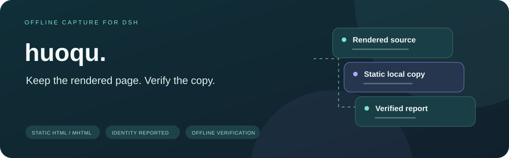
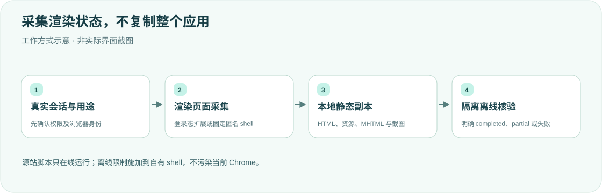

<div align="center">

<h1>huoqu · 把网页留在本地</h1>
<p><strong>保存当前渲染状态，而不是假装复制整个网站。</strong></p>
<p>DeepSeek Harness 的静态 HTML / MHTML 采集与离线核验插件。</p>
<p><strong>简体中文</strong> · <a href="README.en.md">English</a></p>
<p><a href="package.json">v0.2.3</a> · <a href="LICENSE">MIT</a> · DSH desktop plugin</p>
<p><a href="#核心能力">核心能力</a> · <a href="#工作方式">工作方式</a> · <a href="#快速开始">快速开始</a> · <a href="#用途与身份">用途与身份</a> · <a href="#产物与边界">产物与边界</a> · <a href="#验证">验证</a></p>
</div>

---

面向个人桌面工作流的参考实现。普通采集默认复用当前 Chrome 登录身份；自动化和网页回归使用自有、匿名的真正无头后端。身份不可用时明确失败，不悄悄把登录页面换成匿名页面。

## 核心能力

<table><tr>
<td width="33%"><strong>🗃 离线静态副本</strong><br/><br/>保存 HTML、资源和 MHTML，不声称复制原站 API、登录态或交互功能。</td>
<td width="33%"><strong>🌐 身份可追溯</strong><br/><br/>用途、后端、实际引擎、请求/实际身份、归属与降级原因写入报告。</td>
<td width="33%"><strong>🧪 离线核验</strong><br/><br/>自有固定 shell 断网、禁 JS 检查 HTML/MHTML，输出源站与本地截图。</td>
</tr><tr>
<td><strong>🖼 资源本地化</strong><br/><br/>处理普通图片、CSS与可安全内联的 SVG paint；无法完整保存返回 partial。</td>
<td><strong>🛡 会话文件策略</strong><br/><br/>复用官方 sandboxPolicy/fs，按真实 loaded Session 限制写入、替换及清理。</td>
<td><strong>🧾 明确结果</strong><br/><br/>已落盘不等于通过；清理失败阻止发布，未知目录不覆盖，取消等待实际退出。</td>
</tr></table>

## 工作方式



默认 capture 经[Chrome 插件](https://github.com/yueyexiayu/dsh-chrome)创建本任务独占的后台 target，不开调试端口、不接管现有标签。离线限制仅施加到自有 shell，不污染借用 Chrome。源站在线加载仍会执行源站自身脚本。

## 快速开始

当前固定浏览器仅验收 macOS arm64；实际环境为 macOS27.0.1，Darwin major低于22拒绝。其他架构、Linux/Windows及其他 macOS 版本不宣称已验收。

```sh
export DSH_HOME="${DSH_HOME:-$HOME/.dsh}"
git clone https://github.com/yueyexiayu/dsh-huoqu.git "$DSH_HOME/plugins/huoqu"
cd "$DSH_HOME/plugins/huoqu"
npm ci --ignore-scripts
npm run install:headless
```

作为 **desktop profile bundle** 加载。在 `$DSH_HOME/profiles/desktop/package.json` 两处都加上 `huoqu`：

- `dependencies`：`link:$DSH_HOME/plugins/huoqu`
- `dsh.profile.bundles`：字符串 id `huoqu`

在该 profile 目录安装依赖，使 `node_modules/huoqu` 解析到本插件。**禁止**再在 desktop `cordis.patch.yml` 里 `- insert:` 同一 id；同一 id 既 bundle 又 insert 会变成两个实例。

**⌘Q 完全退出 DSH 后重开并建立新会话**，侧栏出现「网页获取」。普通登录态采集还需安装配套 Chrome 插件及扩展。实际侧栏 GET `version`、工具新 schema 与结果 `pluginVersion` 应为0.2.3，不能用磁盘版本冒充已加载。

以下为匿名网页回归参数示例；输出路径须是全新目录或可核对归属的既有副本：

```json
{"url":"https://example.com/","purpose":"web-regression","browser_identity":"anonymous","backend":"headless","output_dir":"/tmp/new-capture"}
```

## 用途与身份

| 项目 | 默认与要求 |
| --- | --- |
| `purpose=capture` | `current` 身份，优先当前正式 Chrome；扩展不可用明确失败 |
| `purpose=automation/web-regression` | `anonymous` + owned true headless，不借用用户 Chrome |
| `backend` | `auto`、`current-chrome`、`headless`；auto 依用途/身份，不依据任意异常猜测 |
| `browser_identity=prefer-current` | 显式允许仅在真正扩展不可用/可选模块缺失时匿名降级，并报告原因 |
| 不合法组合 | headless+current、current-chrome+anonymous、automation+current 均拒绝 |
| 输出目录 | 默认 `~/Downloads/huoqu/`；workspace-write 改用工作区或平台临时目录 |

协议、旧扩展、权限、引擎版本及身份错误不允许降级。viewport只调整本任务 target，不移动用户原生窗口；MHTML/资源不携带登录凭据，无法匿名获取的私有素材如实报告。

<details>
<summary><strong>固定浏览器安装、版本与校验</strong></summary>

固定 `playwright-core@1.58.2`、Chromium headless shell revision1208、真实版本145.0.7632.6；不扫描其他项目或选缓存最高版本，不回退 Chrome.app/Chromium.app。校验发布 manifest、完成 marker、安装锁、原生 arm64 Mach-O、全部17个安装文件 SHA-256和实际 `--version`，不是看文件名或可执行位。

默认 Playwright 缓存是 `~/Library/Caches/ms-playwright`。`PLAYWRIGHT_BROWSERS_PATH=0` 为插件包内安装；指定相对路径按 execution cwd。安装与启动 Host/测试必须采用同一缓存语义；同名变量优先于 npm config，即使为空也占优先级。相对路径刻意忽略 INIT_CWD。`HUOQU_CHROME_PATH` 只允许完整相同固定安装；空值、伪装二进制、GUI symlink、其他版本拒绝。

[浏览器测量清单](lib/headless-browser.lock.json)记录官方 CLI 下载字节的本地测量 SHA，不是上游签名。更新/扩平台需同步依赖、lock和真实 OS/架构验收。共享执行策略来自随仓库 vendored 的 `0.2.1-alpha.4.browser-policy.1` 私有 off-cycle artifact，不是官方 full release，不改已安装 ASAR。

</details>

## 产物与边界

| 文件 | 内容 |
| --- | --- |
| `index.html` / `assets/` | 本地入口及资源 |
| `index.mhtml` | 单文件静态副本 |
| `source.png` / `local.png` | 源站与本地预览截图 |
| `report.json` / `manifest.json` | 验证结果、失败原因与归属清单 |

- 去除脚本、事件、嵌入页及主动跳转，添加 CSP；离线浏览器禁 JS、不开放跨本地文件读取特权。滚动以加载懒内容，但不自动点击业务按钮/轮播/fullpage API，未渲染或需点击的内容可缺失。
- 普通 SVG paint 可内联；含主动内容、重复ID或样式表的 SVG 不晋升宿主DOM。无法本地化按失败/partial记录，不通过删除样式伪造完整还原。保留真实 DOCTYPE，短页面不因旧1000字符门槛误拒绝。
- 输出目录必须为空或由 manifest/report及资源证明属于既有 huoqu副本；不因名字像 index.html/assets 就覆盖。替换失败恢复旧内容，恢复失败保留备份并报告。
- 只有资源完整、离线HTML/MHTML预览及内容/图片检查通过、浏览器清理成功，才是 `completed`；否则 `partial` 或明确失败。清理失败阻止新发布和旧副本替换，并报告残留profile。
- 额外资源最多1200次，读取共1000MiB（失败响应也计入）；普通资源单个200MiB，音视频640MiB，最终MHTML1000MiB。404/410引用可移除而不因此判整次失败。

<details>
<summary><strong>权限、后台任务及取消</strong></summary>

工具和全部侧栏HTTP操作要求真实有效且已加载的 sessionId；不主动加载历史、不接受 agentless 或请求伪造 scope/cwd/提权。缺失/畸形400，历史或未加载403，服务不可用503。跨会话资源返回404，不泄露URL或路径。权限在排队与每次写入、回滚、清理前重查，缺服务/未知策略拒绝；read-only不能采集，但可查看/打开自己既有结果并请求停止。

侧栏串行，最多4个运行/排队任务；排队开始240秒后请求停止，等实际清理退出才释放位置。终态最多保留1小时/40条，Host重启不恢复任务。会话切换丢弃迟到响应，卸载会等待清理。权限收紧阻止清理时报告残留位置，不越权删除。macOS open 等待退出结果才确认打开成功。

</details>

## 验证

```sh
cd "$DSH_HOME/plugins/huoqu"
for file in lib/*.js; do node --check "$file" || exit 1; done
node --test test/*.test.mjs
```

Host/桥接回归依赖同级 Chrome 插件。可选 `HUOQU_BROWSER_TESTS=1` 使用固定隔离shell；`DSH_OFFICIAL_ROOT` 可指向只读官方包验证真实SessionStore/权限契约。fixtures不接用户正式Chrome；模拟、合成页面与源码测试不能替代已部署采集验收。Host/Client 改动需 ⌘Q 重开后用新会话核对侧栏。

## 许可

[MIT License](LICENSE)。这是静态渲染状态采集器，不是原站完整备份、交互回放或登录凭据迁移工具。

<div align="center"><sub>保存有范围，完成有证据。 · <a href="README.en.md">Read in English →</a></sub></div>
